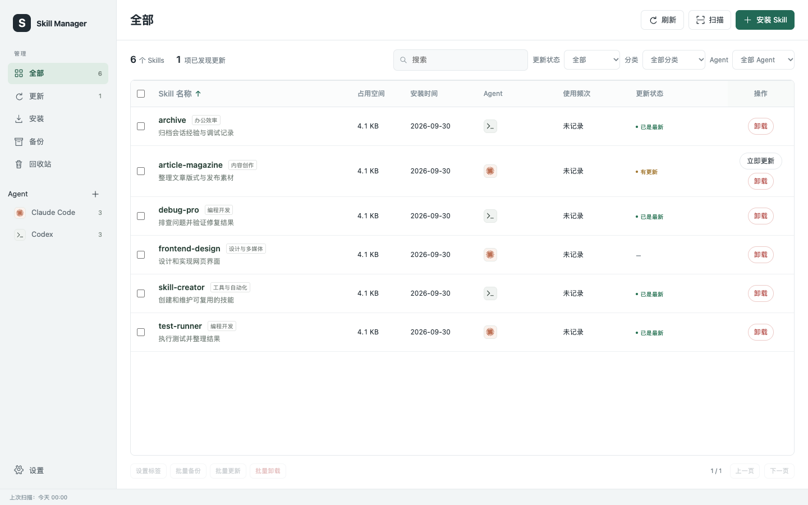

# Agent Skill Manager

[English](./README.md) | 中文

## 项目简介

Agent Skill Manager 把本机安装的 Skills 集中到一个管理页面。适合希望看清多个 Agent 中装了什么、安全维护本地技能，并发现新 Skills 的用户。

本地 Web 后台是主要入口，也可以让 Agent 调用 Python CLI。两者共用 SQLite 数据库和维护逻辑，运行管理器本身不需要模型 API。

## 效果预览



## 核心功能

| 功能 | 可以做什么 |
| --- | --- |
| 统一列表 | 合并展示同一 Skill 的 Agent 关联，查看安装时间、占用空间、分类和更新状态；磁盘上的独立安装目录仍各自保留。 |
| 首页与发现 | 首页概览 Skills、Agent、可用更新和磁盘占用；商店提供分页榜单、分类和按名称搜索。首页展示近期核实的 Skills；只有符合条件的项目不少于 5 个时才显示“今日推荐”。 |
| 检查更新 | 针对所有可检查的已安装 Skills 比对登记来源；界面区分查询失败与已找到来源但缺少可信比较基线。成功结果在 15 分钟内复用，失败项可重试，并遵守来源服务的限流规则。 |
| 安装 Skills | 支持公开仓库链接、HTTPS ZIP 链接、本地文件夹和 ZIP，选择 Agent 与安装位置后安装。 |
| Agent 目录 | 使用预设添加 Agent，自动匹配操作系统的默认路径；也可在设置中登记自定义目录。 |
| 备份与恢复 | 创建、恢复备份，扫描已配置位置中的历史备份；删除的备份和卸载的 Skills 进入回收站，回收站项目经确认后才永久删除。扫描未完成时保留错误详情，不把部分结果当作完整清单。 |
| 分类与标签 | 自动补齐缺失的分类或标签，也可手动调整，并直接筛选列表、点击表头排序。 |
| 操作记录 | 查看失败或中断的操作，需要排查时导出诊断记录。 |
| 缓存清理 | 查看并清理管理器过期的临时文件，不触碰已安装 Skills 和备份。 |
| 项目空间清理 | 扫描选中的 Agent 项目、按磁盘占用排行，批量分析选中项目，查看重复素材和缓存建议及删除影响；确认后移入现有回收站。 |

## 安装

### 配置要求

使用支持本地 Skills 和本地命令执行的 Agent。Codex、Claude Code 可读取根目录的 `SKILL.md` 并调用 Python 入口。

| 项目 | 要求 |
| --- | --- |
| Python | Python 3.10 或以上；核心使用标准库，包括 SQLite。 |
| 浏览器 | 使用本地管理后台需要较新的桌面浏览器。 |
| Git 与网络 | Git 来源检查和更新需要 Git；公开来源服务可能限制请求次数。 |
| 文件选择器 | macOS 使用系统选择器，其他平台在可用时使用 Python Tkinter；也可手动填写本地路径。 |
| 操作系统 | 已在 macOS 测试。Windows 路径与适配代码经过审查及模拟测试，但尚未进行 Windows 真机测试；Windows 不支持自动创建共享链接。 |
| 可选翻译 | 首页英文简介可调用本机 Ollama 的 `qwen3.5:4b` 模型翻译（可用 `SKILL_MANAGER_TRANSLATION_MODEL` 指定其他模型）。没有该服务也能使用管理器，简介不会发送给在线翻译服务。 |

### 快速安装

直接对 Agent 说：

```text
把 https://github.com/chemny/skill-manager 安装为本地 Skill。
先检查运行环境，安装后确认你能读取并运行它。
```

Agent 应告知实际安装位置，以及命令行入口是否可用。

## 快速开始

```text
用 skill-manager 扫描我已安装的 Skills，并打开管理后台。
```

管理页面会在本机打开。首页先展示安装概览和近期 Skills；进入“全部”管理 Agent 的 Skills，进入“发现”浏览目录。“刷新”核对已登记项目，“扫描”发现已配置目录中的变化。

## 使用示例

### 检查更新

```text
检查我所有已安装 Skills 的更新，列出有新版本的项目。
```

检查不会自动安装。更新使用登记的来源，替换前备份本地内容；缺失来源、查询失败或缺少可信比较基线都不会被当作“已是最新”。

### 安装一个 Skill

```text
把这个 Skill 安装给 Codex 使用：<仓库链接或本地文件夹>。
```

管理器先识别内容和安装位置，再写入文件，不会静默覆盖已经存在的安装目标。

### 备份与恢复

```text
备份我已安装的 Skills，方便之后恢复。
```

备份出现在“备份”列表中。扫描可查找已配置位置中的历史备份；扫描未完成时会列出未覆盖位置，结果仍是部分结果。删除备份后进入“回收站”，永久删除在回收站中执行。网页中的删除类操作会弹出确认框；恢复到已有不同内容的位置时，需要选择替换，并先备份原有内容。

### 管理另一个 Agent

```text
把 OpenCode 添加到管理器，显示它已安装的 Skills。
```

预设会使用当前操作系统对应的默认目录。移除 Agent 管理配置不会删除它的 Skills 文件。共享目录可能供多个 Agent 使用，卸载其中的共享内容会影响这些 Agent。

### 发现一个 Skill

```text
帮我找最近上架的写作和文档类 Skills。
```

商店通过公开目录提供榜单、分类和按名称搜索。搜索只覆盖各来源本次读取的候选，出现范围提示时不能把结果当作全量。目录结果不会自动成为本机已安装 Skill 的更新来源。“今日推荐”会核实仓库内存在可用的 `SKILL.md` 并检查近期证据；不足 5 条时，首页改为展示今日上新。

## 工作原理

### 清理项目空间

进入“空间清理”，点击“扫描项目”，选择识别到的 Agent 和项目位置。管理器记住勾选和排除范围；“重新扫描”只更新已添加项目，再次“扫描项目”可以加入新发现的位置。

按占用空间查看项目，勾选后点击“分析选中项目”。建议列出清理内容、文件数、大小和删除影响，默认不勾选、不自动移动。用户确认后才进入现有回收站；恢复不覆盖同名文件，永久删除需要另行确认。

分析核对相同内容和本地路径引用，保留原始输入、模型及已识别的模型依赖。大文本分块检查，后续分析可复用缓存、继续未完成部分。空间统计、重复检测和引用检查分别记录完成情况，部分结果不会冒充完整结果。没有发现引用不代表没有使用；即使保留相同副本，删除原路径仍可能影响旧报告或预览。候选大小不是保证可释放空间。

项目发现支持本机可用的 Codex、Claude Code、Cursor、Windsurf 和 OpenClaw 元数据；实际项目分析已在 macOS 的 Codex 项目中验证。安全移动项目文件需要 POSIX 目录及防跟随校验支持，Windows 暂不支持此类移动。详见[项目空间规则与支持范围](references/project-space.md)。

### 本机数据与维护

管理器扫描配置的目录，在 SQLite 中记录安装项目、来源证据、更新结果和操作历史。页面复用 15 分钟内的清单数据，备份列表缓存一小时；发现结果和翻译简介也在本机缓存。外部目录和 GitHub 请求有频率限制，来源可能分别失败；写入操作完成后刷新受影响的记录。

| 组件 | 职责 |
| --- | --- |
| `SKILL.md` | Agent 使用管理器时遵循的指令。 |
| `scripts/agent_skill_manager.py` 与 `bin/asm` | Python CLI、本地 Web 服务和 macOS/POSIX 命令包装器；Windows 可直接调用 Python 脚本。 |
| `assets/maintenance.html` | 首页、清单、发现、更新、安装、备份、回收站和设置界面。 |
| `scripts/` 内的维护模块 | 来源检查、内置归属判断、文件校验、备份、任务执行与恢复。 |

服务只监听本机回环地址，使用本地请求令牌。默认数据保存在 `~/.agent-skill-manager`，可用 `ASM_HOME` 指定隔离的数据目录。发现、来源检索和更新检查会请求公开服务；可选翻译只调用本机 Ollama。诊断记录可能包含本机路径，分享前请核对内容。

内置归属依据实际证据判断，不把整个 Agent 目录一律视为不可操作。清理建议仅供参考：版本较旧或存在同名副本，都不足以证明内容可以安全删除。

## 目录结构

```text
SKILL.md                         Agent 使用指令
scripts/                         CLI、服务与维护模块
bin/asm                          POSIX 命令包装器
assets/maintenance.html          管理后台
assets/project-space.html        项目空间页面
assets/project-space.js          项目空间交互
assets/skill-manager-preview.png 首页示例数据截图
references/                      使用、接口与图标来源文档
tests/                           隔离自动化测试
README.md / README.zh.md         英文与中文介绍
LICENSE                          项目许可
```

详细信息见[维护命令](references/maintenance.md)、[Web API](references/web-api.md)、[浏览器回归测试](references/browser-tests.md)、[Agent 图标来源](references/agent-icons.md)和[中文用途目录](references/purpose-zh.json)。开发变更记录在 [CHANGELOG.md](CHANGELOG.md)。

## 许可

项目代码采用 [MIT 许可](LICENSE)。第三方图标保留各自声明，见[图标来源与许可](references/agent-icons.md)。产品名称和标志用于识别对应产品，不代表获得其背书。

## 关于我

项目维护于 [chemny/skill-manager](https://github.com/chemny/skill-manager)。可通过仓库的 [Issues](https://github.com/chemny/skill-manager/issues)反馈可复现的问题或改进建议。
